# Mini-SOC Home Lab — Wazuh SIEM + Attack Simulation

Isolated home lab simulating attacks against a Windows host, detecting them with Wazuh (SIEM), analyzing the alerts, and applying a response — a small-scale SOC Analyst workflow.

## Architecture

```
Kali Linux (attacker)  --->  Windows 11 "win-victim" (Wazuh agent + Sysmon)  --->  Wazuh (SIEM)
192.168.56.104                192.168.56.103                                      192.168.56.102
```

All three VMs run on a VirtualBox Host-only network (`192.168.56.0/24`), isolated from the internet and the host's LAN (communication limited to the host machine and VMs on this virtual network).

| Component | Role |
|---|---|
| Wazuh | SIEM — log collection, analysis, alerting |
| win-victim (Windows 11) | Target, monitored via Wazuh agent + Sysmon |
| Kali Linux | Attacker machine |

## Setup

1. **Wazuh** deployed from the official OVA.
   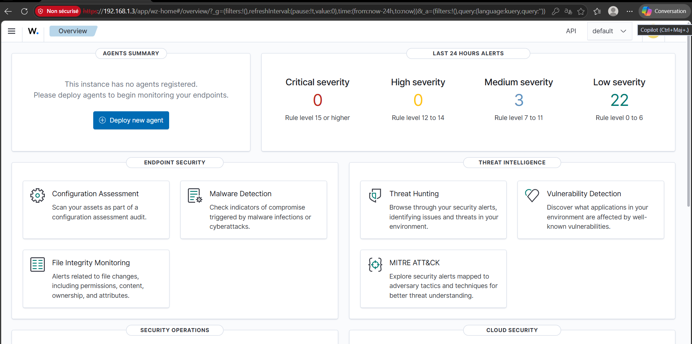
2. **Windows 11** installed, clean snapshot taken.
   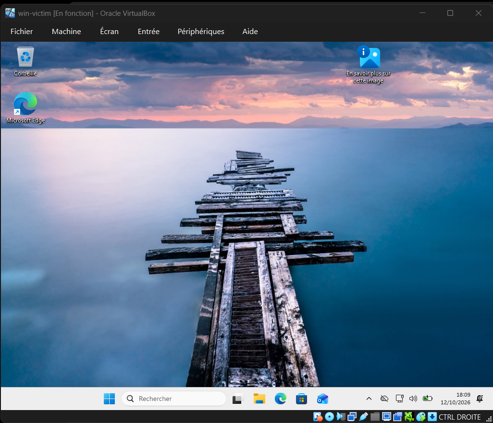
3. **Wazuh agent** installed via MSI and connected to the manager.
   ```powershell
   Invoke-WebRequest -Uri https://packages.wazuh.com/4.x/windows/wazuh-agent-4.14.8-1.msi -OutFile $env:tmp\wazuh-agent.msi
   msiexec.exe /i $env:tmp\wazuh-agent.msi /q WAZUH_MANAGER='<manager-ip>' WAZUH_AGENT_NAME='win-victim'
   NET START Wazuh
   ```
   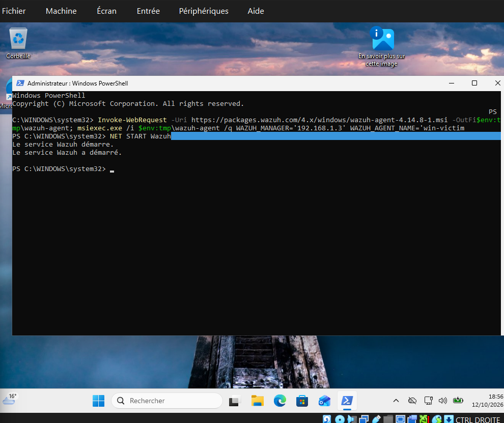
   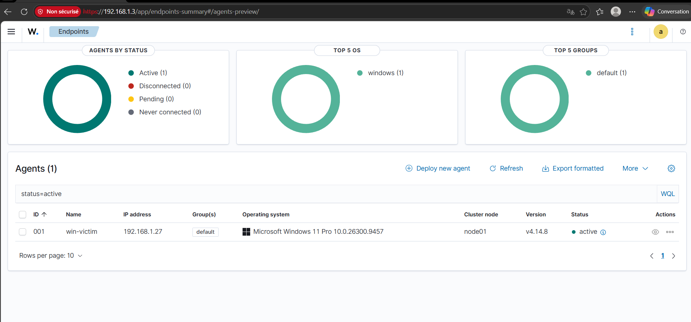
4. **Network isolation**: both VMs switched from NAT to Host-only.
   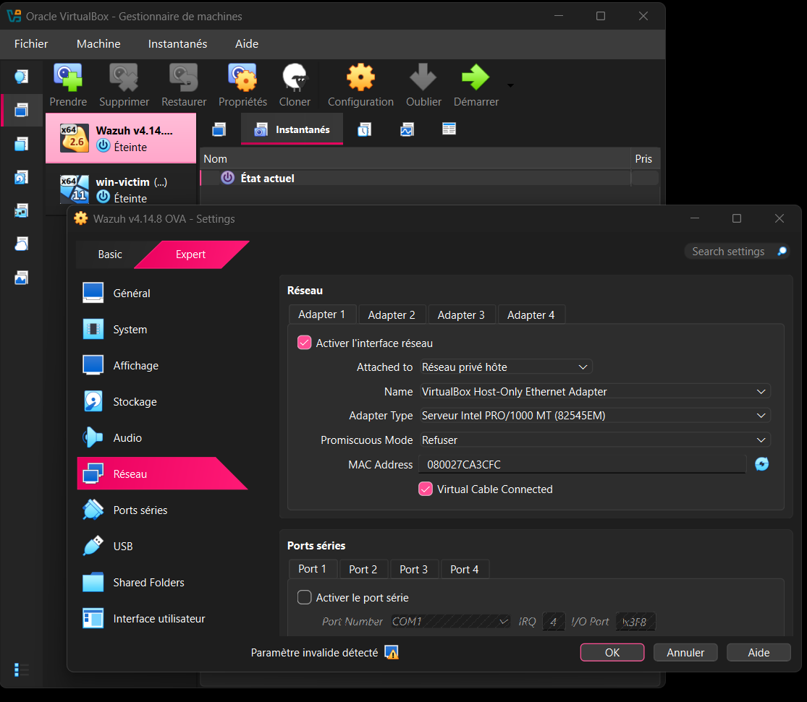
   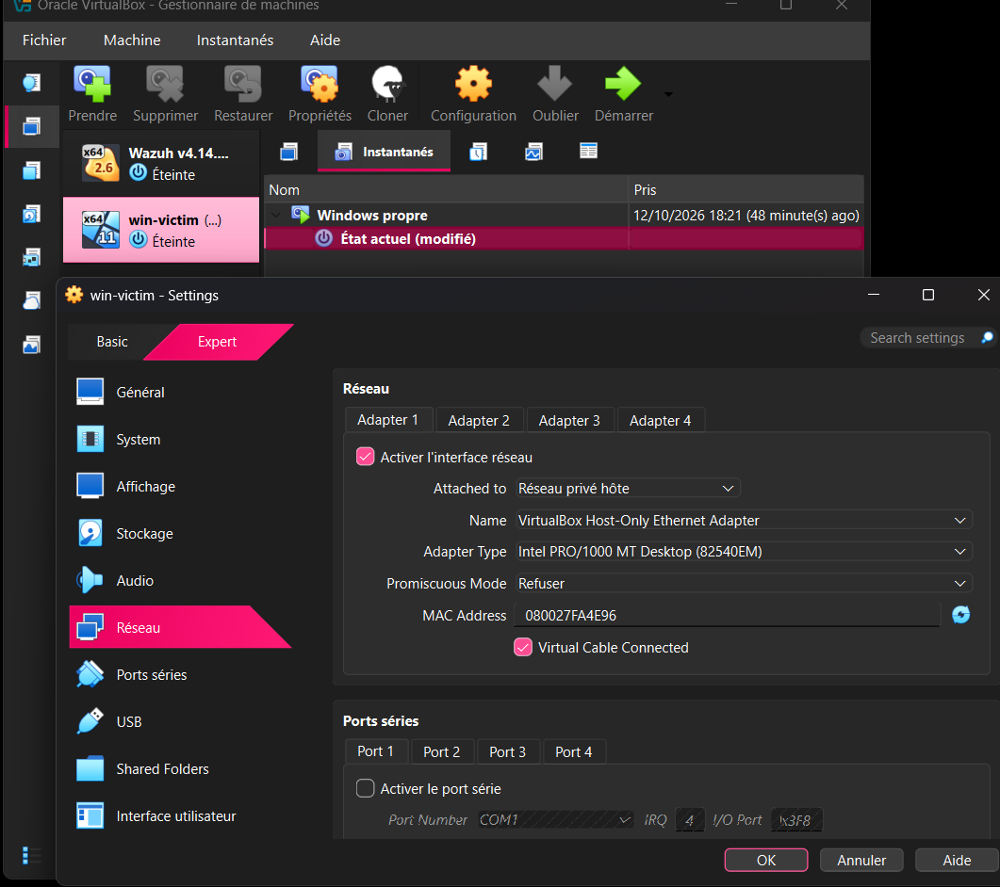
   New IPs: Wazuh `192.168.56.102`, win-victim `192.168.56.103`.
   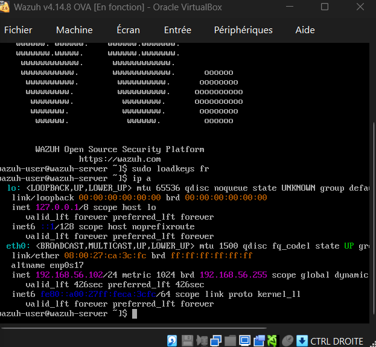
   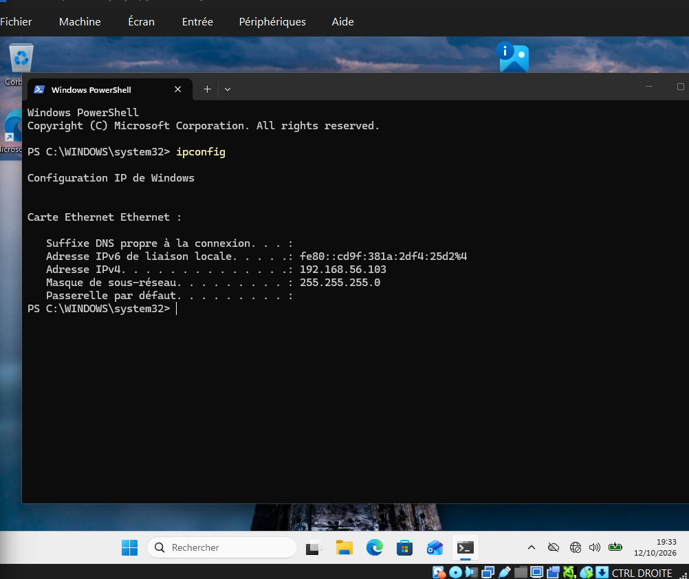
   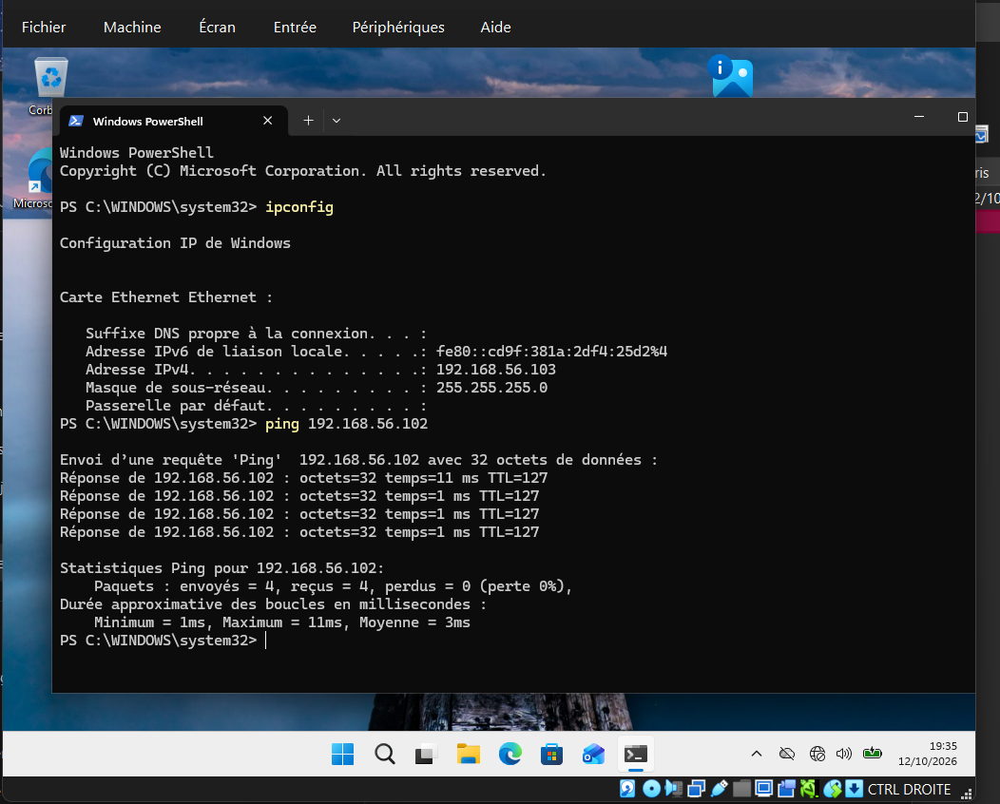
5. **Agent reconnected** to the new manager IP, API back Online.
   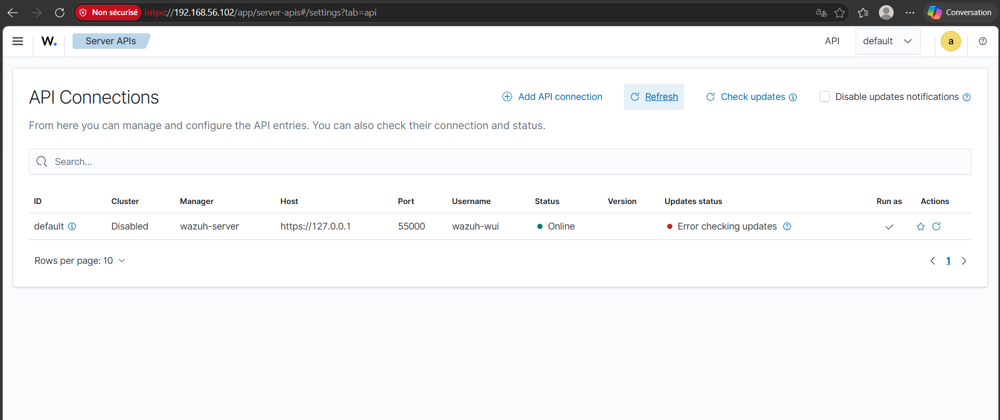
6. **Sysmon** installed for detailed event logging. Agent config updated to collect it:
   ```xml
   <localfile>
     <location>Microsoft-Windows-Sysmon/Operational</location>
     <log_format>eventchannel</log_format>
   </localfile>
   ```
   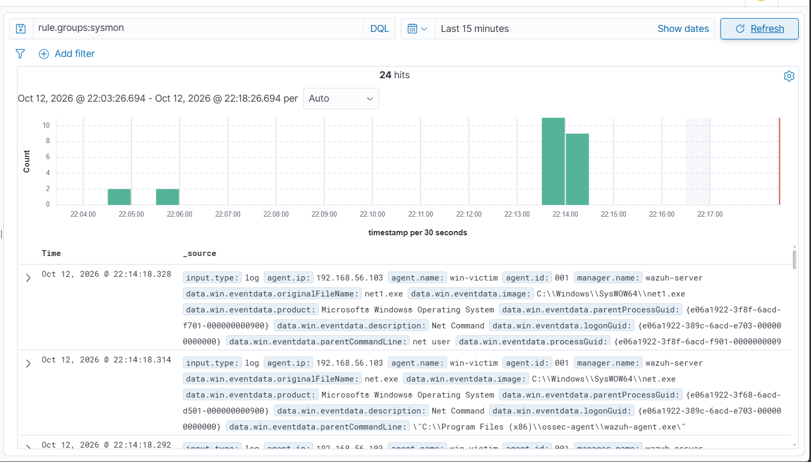
7. **Kali Linux** added to the same Host-only network.
   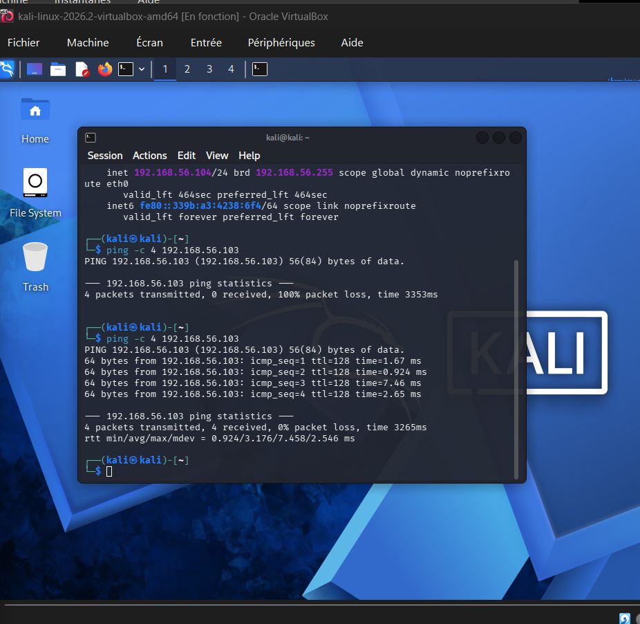

## Attack Simulation & Detection

### 1 — Port scan (filtered)

```bash
nmap -sV 192.168.56.103
```
Result: all 1000 ports filtered by the Windows Firewall — no connection ever completed.
No corresponding event was observed in Wazuh for this time window, not even in Sysmon (Sysmon's network logging only fires on completed connections). Windows Firewall logs and audit policy were not inspected directly, so this doesn't prove nothing was recorded anywhere on the host — only that nothing reached Wazuh.

*(RDP was still disabled on win-victim at this stage — see next step.)*

### 2 — Aggressive scan (RDP enabled for testing)

RDP was deliberately enabled on win-victim beforehand (service + firewall rule) to have a real service to probe:
```powershell
Set-ItemProperty -Path 'HKLM:\System\CurrentControlSet\Control\Terminal Server' -Name "fDenyTSConnections" -Value 0
Enable-NetFirewallRule -DisplayGroup "Bureau à distance"
```
```bash
sudo nmap -A -T4 192.168.56.103
```
Nmap identified the exposed RDP service and retrieved host info via `rdp-ntlm-info` (hostname `VICTIM`, Windows build `10.0.26100`).
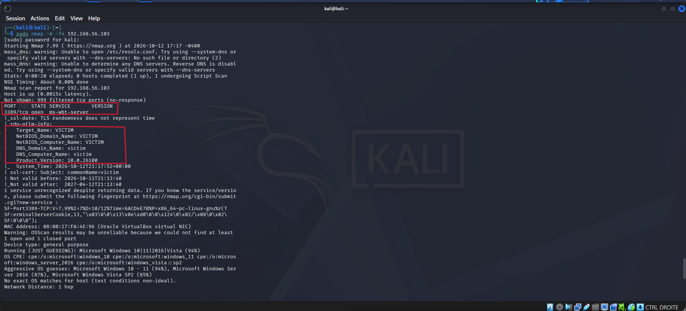

### 3 — Failed RDP authentication

```bash
xfreerdp /v:192.168.56.103 /u:test /p:wrongpassword
```
Failed logon (`ERRCONNECT_LOGON_FAILURE`) → Windows Event ID 4625, picked up immediately by Wazuh.

Query: `agent.name:win-victim AND data.win.system.eventID:4625`

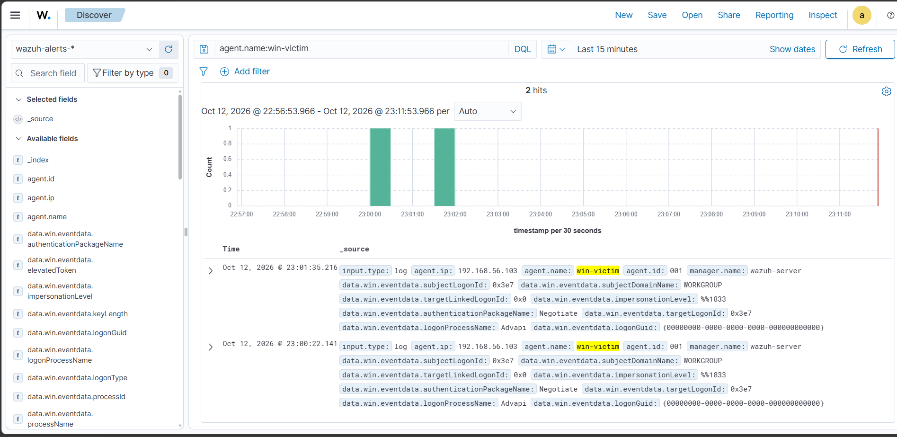

| Field | Value |
|---|---|
| Source IP | `192.168.56.104` (Kali) |
| Workstation | `kali` |
| Target account | `test` |
| Auth package | NTLM |

A single failed login is a suspicious/unauthorized authentication attempt, not on its own proof of brute-force — repeated failures would be the actual indicator. This alert comes from Windows' native Security audit log (collected by Wazuh by default), not from Sysmon.

## Response

Based on the above (one suspicious failed authentication attempt from an unauthorized source), the source IP was blocked on the host firewall:

```powershell
New-NetFirewallRule -DisplayName "Block Kali Attacker" -Direction Inbound -RemoteAddress 192.168.56.104 -Action Block
```
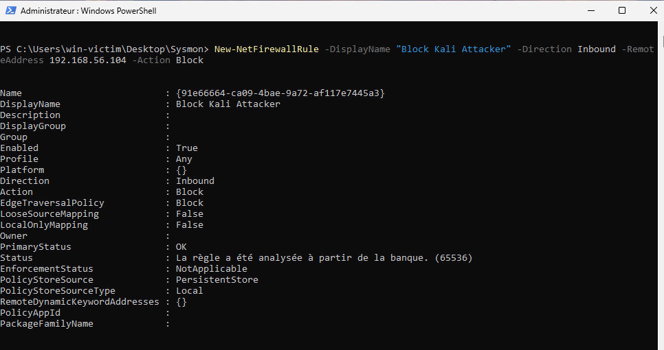

Verified by retrying the connection from Kali:
```bash
xfreerdp /v:192.168.56.103 /u:test /p:wrongpassword
```
Error changed from `ERRCONNECT_LOGON_FAILURE` to `ERRCONNECT_CONNECT_FAILED` — connection now fails before authentication, consistent with the firewall block.

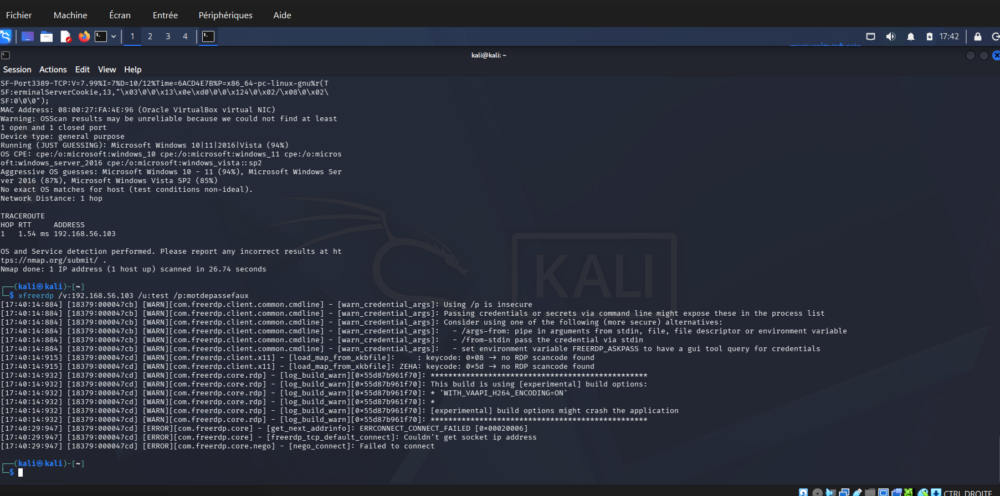

## Incident Summary

| Stage | Description |
|---|---|
| Detection | Failed RDP authentication (Event ID 4625) |
| Analysis | Source `192.168.56.104` (kali), target account `test` — failed RDP authentication attempt |
| Classification | Low/medium severity |
| Response | Source IP blocked on host firewall; block verified |

*In a real SOC, Tier-1/2 analysts typically detect, triage, and recommend action rather than apply the block themselves (handled by infra teams or automation like Wazuh Active Response). The manual block here is for demonstration.*

## Key Takeaways

- A correctly configured host firewall can make scans invisible at the log level — there's nothing to log if no connection completes.
- Event ID 4625 (failed logon) is covered by Wazuh's default Windows auditing, independent of Sysmon.
- Sysmon adds value mainly for process/network visibility, not authentication events.
- A single failed login ≠ brute-force; context (frequency, repetition) determines severity.

## Possible Improvements

- Wazuh Active Response to auto-block after N failed logins
- Custom rule for repeated 4625 events (brute-force detection)
- Additional attack scenarios (Mimikatz, lateral movement, PowerShell abuse)
- MITRE ATT&CK mapping

## Tools

VirtualBox · Wazuh 4.14.8 · Sysmon · Kali Linux (Nmap, xfreerdp) · Windows 11

## Disclaimer

Built and operated entirely within an isolated virtual network for educational purposes.
